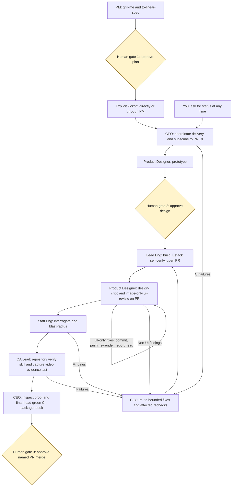

# Estack for Capy

This package adapts the Codex and Devin Estack workflows for Capy. Skills retain their supporting files in `skills/`. The package does not provision services, credentials, or application environments.

## Install

For cloud threads, add this GitHub folder as a plugin in **Settings → MCP & plugins → From GitHub repository** using the repository's `estack-capy` folder URL. For a private repository, install the Capy GitHub App on it first. Use **Sync** on the plugin page after changes are pushed. Plugin skills are not available on paired-device threads.

Alternatively, copy the desired complete skill folders into a Drive scope's `skills/` directory, or into a repository's root `.agents/skills/` directory and commit them. Start a new thread on the updated branch for repository skills. Copies do not update automatically; copy them again to refresh. Include the referenced sibling skills when a workflow calls them.

Use `$estack` or `$poteto-mode` in a task, or select a skill with the composer. Capy resolves duplicate names in repository, Drive, built-in, then plugin order. Check the picker if a skill does not appear. Capy ignores plugin hooks and custom agent profiles, so invocation does not persist through a hook. Invoke the workflow again when needed. Delegation uses Capy's subagents and available tools rather than Devin or Codex agent profiles.

See [Capy's skill documentation](https://docs.capy.ai/skills) and [plugin documentation](https://docs.capy.ai/integrations/plugins). Editing this package does not publish or install it.

## Video evidence

Use [capture](skills/capture/SKILL.md) for required video evidence and polished same-take walkthroughs. It uses native Capy recording or the documented macOS capture path, preserves originals and provenance, and bundles the shared compositor. Its [finishing dependencies](skills/capture/references/runtime.md) are provisioned separately. Native recordings preserve their source cursor. They do not supply the Codex adapter's synchronized pointer timeline. Image-only UI review keeps its existing screenshot workflow and publishing.

## Standalone work and coordinated delivery

[Estack](skills/estack/SKILL.md) selects the relevant [poteto-mode](skills/poteto-mode/SKILL.md) playbook and repository requirements. Standalone tasks follow that playbook directly. Coordinated delivery starts only when you explicitly hand approved scope to the CEO. Specialists then execute bounded stages rather than restarting the full workflow.

The [Delivery playbook](skills/poteto-mode/playbooks/delivery.md) defines the reusable contract. Captain names below describe Evan's setup, not a roster installed by the plugin.

During UI review, Product Designer commits UI-only fixes to the PR branch itself, runs the relevant local checks, re-renders the round, iterates rounds directly with you, and reports each new head to the CEO. Staff Eng's review covers those commits. The CEO routes every other finding to Lead Eng and resumes the failed and affected gates on the new head. Unchanged, still-valid approvals do not need another full pass. Later UI fixes rerun affected QA journeys and video evidence.

## Captain responsibilities

| Captain | Owns | Skills and playbooks | Returns |
| --- | --- | --- | --- |
| PM | Context, product decisions, and the lean authoritative spec | [grill-me](skills/grill-me/SKILL.md), [to-linear-spec](skills/to-linear-spec/SKILL.md) | Approved scope, open questions, and exact kickoff authorization when given |
| CEO | Routing, priorities, status, evidence acceptance, and CI through a PR subscription | [Estack](skills/estack/SKILL.md), [Delivery](skills/poteto-mode/playbooks/delivery.md) | Current stage, checked proof, blockers, and the named per-PR merge package |
| Product Designer | Design candidates, independent visual review on the PR, and UI-only fixes during that review | [prototype](skills/prototype/SKILL.md), [design-critic](skills/design-critic/SKILL.md), [ui-review](skills/ui-review/SKILL.md) | Design revision, sourced approval, image evidence, and concrete findings |
| Lead Eng | Implementation, local self-verification, PR creation, and all engineering fixes | [Estack](skills/estack/SKILL.md), [Feature](skills/poteto-mode/playbooks/feature.md), [Opening a PR](skills/poteto-mode/playbooks/opening-a-pr.md) | PR, exact head, executed local checks, and fix results |
| Staff Eng | Independent technical review | [interrogate](skills/interrogate/SKILL.md), [blast-radius](skills/blast-radius/SKILL.md), relevant Estack review obligations | File-grounded findings, inspected head, proof, and verdict |
| QA Lead | Final acceptance journeys and PR video evidence | The repository's own verify skill, [Estack](skills/estack/SKILL.md), [capture](skills/capture/SKILL.md) | Passed, failed, or blocked criteria, exact head, environment, and final video |

All Captains use Estack for substantive work. Only the CEO monitors CI. Specialists do not poll, wait on, or babysit checks. They return local proof for the supplied head while the CEO subscribes to the PR, routes failed checks to Lead Eng, and confirms green CI before the final package.

## Four separate authorizations

- Plan approval settles the named spec. It does not start prototypes or implementation.
- Explicit kickoff starts CEO-led delivery for that scope. You can give it directly or ask PM to forward it.
- Design approval selects a specific revision before implementation. Cosmetic corrections within that design proceed autonomously. Material changes reopen only the affected decision.
- Merge approval names each PR and its authorized revision. No earlier approval, green check, or autonomy grant authorizes merge or auto-merge.

## Bounded fixes and escalation

The initial failed run is not a fix attempt. After two failed fix attempts for the same failure, an independent diagnosis tests the assumed root cause. At most one in-scope recovery attempt follows. Another failure escalates to you. Renaming a finding or starting a thread does not reset the count.

Material scope or design changes, unresolved access, and safety actions escalate early. Engineering writes stay in Lead Eng's builder crew, except UI-only fixes that Product Designer commits during UI review. Other independent reviewers remain code-read-only.

## Reports and evidence

Every specialist explicitly reports to the CEO with `message_agent`. A cross-Captain message does not transfer crews or automatically forward a child's report. Reports include the authoritative issue, verdict, exact head, commands or journeys, observed results, artifacts, unresolved findings, and sourced approvals. Direct approvals travel with your exact words, source, timestamp, revision, and limits, without asking you to relay them.

The existing delivery issue holds mutable delivery state. The CEO inspects underlying proof before accepting a stage. Old-head evidence and a successful dispatch do not prove the current head passed.

[ui-review](skills/ui-review/SKILL.md) supplies images only. QA uses [capture](skills/capture/SKILL.md) for final video evidence after the review gates. Evan accepted public PR images and recordings after disclosure that the URLs are public and dev data is copied from production, saying "this is totally fine" on November 25, 2026. Final media uses `tools.pr.uploadAsset` and the Markdown it prescribes. Secrets and credentials must never appear. A Drive link to the complete HTML review remains optional. See the [publishing policy](skills/ui-review/references/publishing.md).
