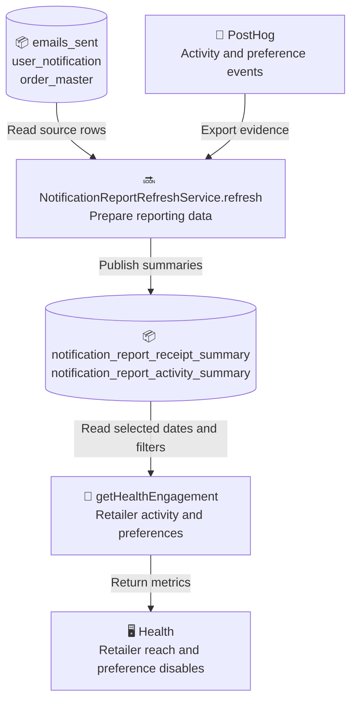
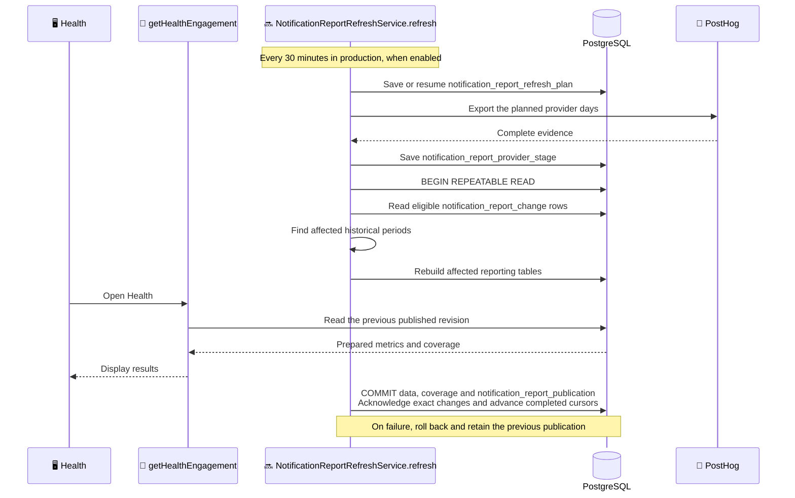

# Reporting walkthrough example

These examples use real identifiers from the Airgoods notification reporting walkthrough.
They show selected paths, not a full table inventory. Verify the target code before reuse.

## Overview

The background job prepares reporting data. The API applies filters to that prepared data
when the user opens Health.

## Sequence

The job publishes reporting changes in one transaction. Dashboard reads during the rebuild
keep the previous complete revision.

This database participant syntax supports a cylinder without an alias. Renderer versions
differ in alias support. Check the visible label before combining aliases and database
types. Keep the symbol and `PostgreSQL` name if an icon alias is unsupported. Do not add
a grouping box to work around that limitation.

## Labels

Prefer `getHealthEngagement` with `Retailer activity and preferences` over a generic
`Reporting API` label. Prefer `notification_report_change` over a shortened `changes`
table name. An identifier explains what to inspect; the short label explains its role.
